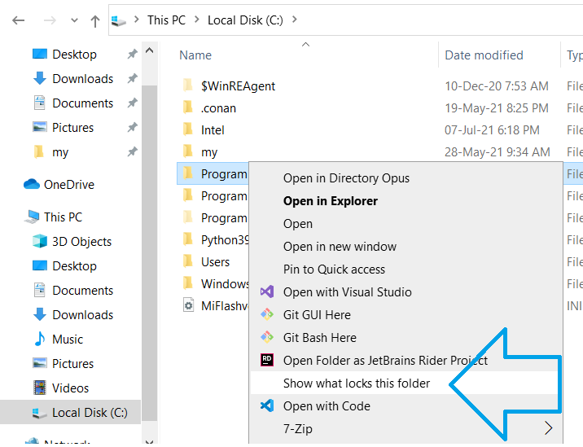
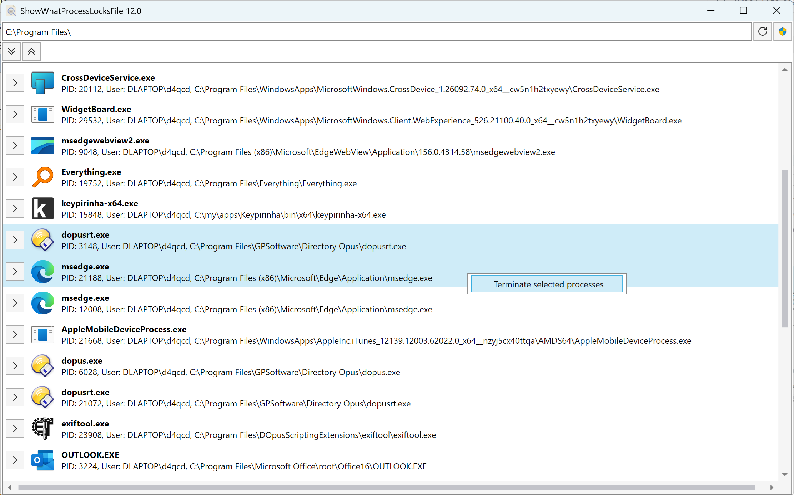

# ShowWhatProcessLocksFile
A simple clone of the [PowerToys File Locksmith](https://learn.microsoft.com/en-us/windows/powertoys/file-locksmith) utility to discover what processes lock a specific file or folder.

## Features
* Very fast
* Lightweight
* Supports Windows 10 and above
* Doesn't require admin rights
* Also shows locks on network shares and mounted drives
* Dark mode support

## Screenshots
### Context menu


### Application


## How to use
* Download the installer from the latest [release](https://github.com/PolarGoose/ShowWhatProcessLocksFile/releases).
* Use `Show what locks this file` in the `File Explorer` context menu to select a file or folder
* To terminate a process, select it and open a context menu by clicking the right mouse button

### Alternative: install via WinGet
```
winget install -e --id PolarGoose.ShowWhatProcessLocksFile
```

## How to build
* To work with the codebase, use `Visual Studio 2026` with a plugin [HeatWave for Visual Studio](https://marketplace.visualstudio.com/items?itemName=FireGiant.FireGiantHeatWaveDev17).
* To build a release, run `.\build.ps1` (`git.exe` should be in your PATH)
