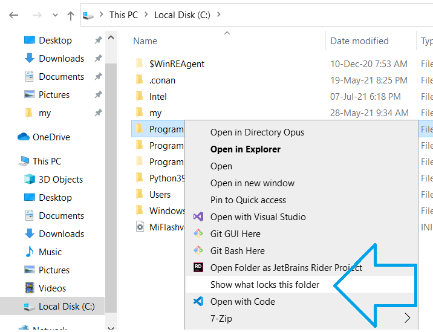
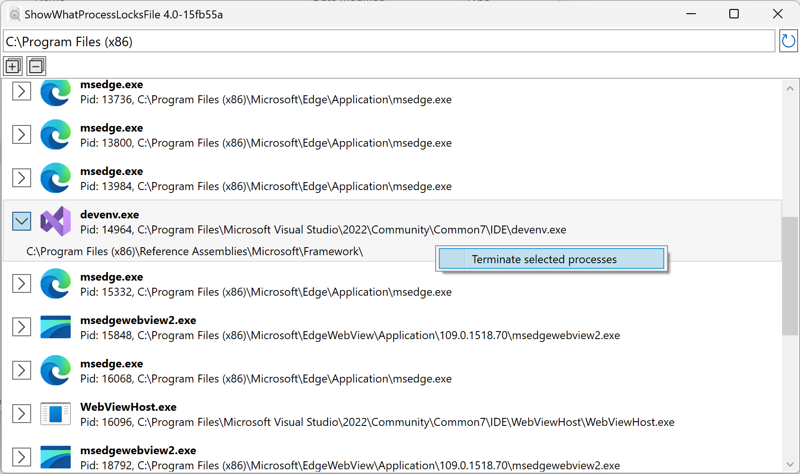

# ShowWhatProcessLocksFile

A simple clone of [PowerToys File Locksmith](https://learn.microsoft.com/en-us/windows/powertoys/file-locksmith) utility to discover what processes lock a specific file or folder.

## Features
* Very fast
* Lightweight
* Supports older versions of Windows
* Doesn't require admin rights
* Also shows locks on network shares and mounted drives
* Follows the Windows light/dark app mode

## Screenshots

### Context menu

### Application

## System requirements

* Windows 10 x64 or higher

## How to use

* Download `ShowWhatProcessLocksFile.msi.zip` from the latest [release](https://github.com/PolarGoose/ShowWhatProcessLocksFile/releases).
* Run the installer. The installer will install this program to the `%LocalAppData%\Programs\ShowWhatProcessLocksFile` folder and add a `Show what locks this file` Windows File Explorer context menu element.
* Use `Show what locks this file` in the ' File Explorer' context menu to select a file or folder
* To terminate a process, select it and open a context menu by clicking the right mouse button
* If you want to uninstall the program, use `Control Panel\Programs\Programs and Features`. The uninstaller will remove the integration from the context menu and all installed files.

## How to build

* To work with the codebase, use `Visual Studio 2022` with a plugin [HeatWave for VS2022](https://marketplace.visualstudio.com/items?itemName=FireGiant.FireGiantHeatWaveDev17).
* To build a release, run `.\build.ps1` (`git.exe` should be in your PATH)
